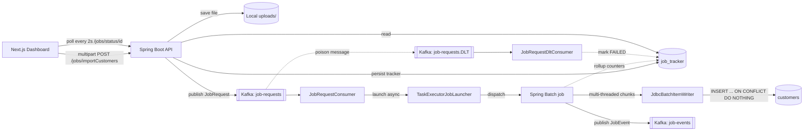

# RTDPS — Real-Time Data Processing System

Asynchronous CSV bulk-loader built on **Apache Kafka + Spring Batch + PostgreSQL**, with a **Next.js 16 + React 19** dashboard that streams live job status.


---

## Architecture



## What problem it solves

CSV bulk-imports over synchronous HTTP have three chronic issues:

1. **The HTTP request thread is held** for the entire duration of the import
2. **No visibility** into progress mid-import
3. **No graceful handling** of transient DB failures or poison rows

RTDPS breaks each with a specific architectural choice:

| Problem | Solution |
|---|---|
| Thread hogging | Kafka + `TaskExecutorJobLauncher` — HTTP returns `202` in ~100ms; job runs on its own thread pool |
| No progress visibility | `JobTracker` persistence + `GET /jobs/status/{id}` polled by the dashboard every 2s |
| Transient DB failures | Spring Batch `retry(3)` on `DataAccessException` |
| Poison messages | Kafka `DefaultErrorHandler` with `FixedBackOff(1000, 3)` → **Dead Letter Topic** → `JobRequestDltConsumer` marks the tracker `FAILED` with origin coordinates |
| At-least-once delivery | `INSERT ... ON CONFLICT (id) DO NOTHING` — redelivered messages are a no-op at the DB |

## Tech stack

| Layer | Tech |
|---|---|
| Language | Java 21 |
| Backend | Spring Boot 3.5.5, Spring Batch, Spring Kafka, Spring Data JPA |
| Data | PostgreSQL 17, Flyway (schema-as-code), Hikari |
| Messaging | Apache Kafka 3.8.1 (KRaft, no Zookeeper) |
| Frontend | Next.js 16, React 19, Tailwind 4, shadcn/ui |
| Runtime | Bun (frontend), Java 21 (backend) |
| Ops | Podman / Docker compose, `spring-dotenv` |
| Testing | JUnit 5, AssertJ, Spring Kafka Test (EmbeddedKafka), Testcontainers, Awaitility |

## Prerequisites

- **Java 21** (SDKMAN, Homebrew, or a vendor JDK)
- **Bun** (for the Next.js dashboard)
- **Podman** or Docker (to run Postgres + Kafka)

## Run it locally

```bash
# 1. Set up local env vars (edit .env if you want overrides)
cp .env.example .env

# 2. Start Postgres + Kafka
podman compose up -d postgres kafka

# 3. Start the backend
./gradlew bootRun                    # http://localhost:9191

# 4. In a second terminal — start the frontend
cd client
bun install
bun dev                              # http://localhost:3000
```

Open **http://localhost:3000**, drop a CSV on the upload panel, and watch the row transition through **Queued → Processing → Completed** in the Recent Jobs table.

## HTTP API

| Method | Path | Purpose |
|---|---|---|
| `POST` | `/jobs/importCustomers` | Multipart CSV upload — returns `202 Accepted` + `trackerId` |
| `GET`  | `/jobs/status/{trackerId}` | Fetch a single job's status + counters |
| `GET`  | `/jobs/all` | List every job, newest first |
| `GET`  | `/swagger-ui.html` | Interactive OpenAPI docs |

The CSV must have this header (order matters):

```csv
id,firstName,lastName,email,gender,contactNo,country,dob
```

## Testing

```bash
./gradlew test
```

| Test | What it covers |
|---|---|
| `RtdpsApplicationTests` | Spring context loads without external deps (Kafka mocked, H2 for JPA) |
| `CustomerProcessorTest` | 7 unit tests — trim, normalize email, capitalize, filter invalid rows |
| `BatchImportIntegrationTest` | **End-to-end**: real Postgres (Testcontainers) + EmbeddedKafka + MockMvc upload → Awaitility polls the tracker → asserts rows land in `customers` |

> The integration test needs a container runtime (Podman or Docker). On macOS with Podman:
> ```bash
> export DOCKER_HOST="unix://$(podman machine inspect --format '{{.ConnectionInfo.PodmanSocket.Path}}')"
> ```

## Project layout

```
src/main/java/me/yswnthdev/rtdps/
├── RtdpsApplication.java
├── config/
│   ├── KafkaConfig.java              # topics + DLT + error handler
│   └── SpringBatchConfig.java        # reader/writer/step/job + async launcher
├── controller/JobController.java     # REST surface
├── dto/
│   ├── JobEvent.java                 # completion event → job-events
│   └── JobRequest.java               # kafka payload → job-requests
├── entity/
│   ├── Customer.java
│   └── JobTracker.java               # per-job status + counters
├── exception/GlobalExceptionHandler.java
├── kafka/
│   ├── JobEventConsumer.java
│   ├── JobEventProducer.java
│   ├── JobRequestConsumer.java       # dispatches to async launcher
│   ├── JobRequestDltConsumer.java    # marks trackers FAILED on poison
│   └── JobRequestProducer.java
├── listener/JobCompletionListener.java
├── repository/
│   ├── CustomerRepository.java
│   └── JobTrackerRepository.java
├── service/
│   ├── BatchJobService.java          # wraps JobLauncher.run
│   └── CustomerProcessor.java        # per-row normalization
└── utils/
    ├── BatchErrorLogger.java         # per-run held-open error log
    └── CustomerFieldSetMapper.java   # CSV row → Customer

src/main/resources/db/migration/
├── V1__spring_batch_metadata.sql     # Spring Batch's BATCH_* tables
├── V2__customers.sql
└── V3__job_tracker.sql
```

## What makes it interesting to talk about

- **Async decoupling** — the Kafka consumer thread stays non-blocking during multi-minute imports thanks to `TaskExecutorJobLauncher` on a dedicated pool (`jobLauncherExecutor`). Prevents `max.poll.interval.ms` eviction and duplicate `JobInstance`s that a synchronous `JobLauncher` would cause.
- **Idempotency across two layers** — `INSERT ... ON CONFLICT (id) DO NOTHING` guards against Kafka's at-least-once redelivery at the DB; a unique `startAt` `JobParameter` guards against duplicate Spring Batch job runs.
- **Fault tolerance** — chunk-level `retry(3)` on `DataAccessException` for transient DB blips; Kafka `DefaultErrorHandler` with `FixedBackOff(1000, 3)` and `addNotRetryableExceptions(DeserializationException, IllegalArgumentException)` so structural failures skip retries and route straight to the DLT.
- **Multi-threaded chunk step** — `SynchronizedItemStreamReader` + `ThreadPoolTaskExecutor` (core=10, max=20) parallelizes each chunk across workers while keeping the single-file cursor thread-safe.
- **Schema-as-code** — Flyway V1 bootstraps Spring Batch's metadata tables (extracted verbatim from `spring-batch-core.jar`); V2/V3 own the domain tables. `ddl-auto: validate` catches drift between JPA mappings and reality.
- **Full observability of state** — every job's read/write/skip counters live in `job_tracker`, and the frontend polls only the active tracker IDs (not the whole list) — O(active) per poll tick, not O(all).

## Screenshots

_Coming soon — dashboard, upload panel, live job status transitions._

---

Built by **Yaswanth Gudivada** — [github.com/Yaswanth6303](https://github.com/Yaswanth6303)
