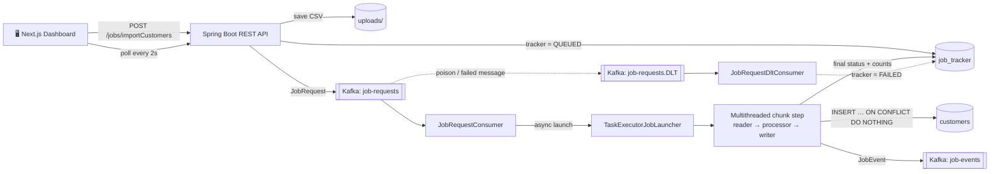

<div align="center">

# ⚡ RTDPS — Real-Time Data Processing System

**Event-driven, multithreaded CSV ingestion pipeline built with Spring Batch, Apache Kafka and PostgreSQL.**

Upload a CSV → get a `202 Accepted` instantly → watch the job move through
**Queued → Processing → Completed** on a live dashboard.

<br />


</div>

---

## 📑 Table of Contents

- [Overview](#-overview)
- [Key Features](#-key-features)
- [Architecture](#-architecture)
- [How a Job Flows](#-how-a-job-flows)
- [Fault Tolerance & Idempotency](#-fault-tolerance--idempotency)
- [Performance](#-performance)
- [Getting Started](#-getting-started)
- [Configuration](#-configuration)
- [REST API](#-rest-api)
- [CSV Format](#-csv-format)
- [Testing](#-testing)
- [Project Structure](#-project-structure)
- [Roadmap](#-roadmap)
- [Author](#-author)

---

## 🧭 Overview

Importing large CSV files over a normal synchronous HTTP request has three problems:

| Problem | How RTDPS solves it |
|---|---|
| ⏳ The request thread is blocked for the whole import | The API stores the file, publishes a job request to **Kafka** and returns `202 Accepted` immediately |
| 🐢 Rows are processed one at a time | A **multithreaded, chunk-based Spring Batch** step processes the file in parallel |
| 💥 Failures are silent or crash the import | **Retries**, **skip logging**, a **dead-letter queue** and a persisted **job tracker** make every failure visible |

---

## ✨ Key Features

- 🚀 **Async ingestion** — Kafka decouples upload from processing; jobs run on a dedicated launcher thread pool.
- 🧵 **Multithreaded chunk processing** — thread-safe reader + 10–20 worker threads, 20 rows per chunk.
- 🔁 **Idempotent writes** — `INSERT … ON CONFLICT (id) DO NOTHING` plus a duplicate-message guard.
- 🛡️ **Fault tolerance** — DB retries, Kafka backoff retries and a dead-letter topic (DLT).
- 🧹 **Data cleaning** — trims fields, lowercases emails, capitalizes names, filters invalid emails.
- 📝 **Per-job skip log** — malformed rows are written to `batch-error-logs/<trackerId>_missing_columns.log`.
- 📊 **Live job tracking** — status plus read / write / skip counts and duration stored in PostgreSQL.
- 🖥️ **Next.js dashboard** — drag-and-drop upload, live status polling, light/dark theme.
- 🗄️ **Schema as code** — Flyway migrations; Hibernate only validates.
- ✅ **End-to-end tests** — real Postgres (Testcontainers) + EmbeddedKafka.

---

## 🏗️ Architecture



---

## 🔄 How a Job Flows

1. **Upload** — `JobController` validates the file (non-empty `.csv`, max 50 MB), stores it in `uploads/`, creates a `job_tracker` row with status `QUEUED` and returns `202` with a `trackerId`.
2. **Queue** — `JobRequestProducer` publishes a `JobRequest` to `job-requests` (3 partitions, keyed by `trackerId`, `acks=all`, idempotent producer).
3. **Consume** — `JobRequestConsumer` checks the request, ignores it if the tracker is no longer `QUEUED`, sets it to `PROCESSING` and launches the job.
4. **Launch** — an async `TaskExecutorJobLauncher` runs the job on its own pool, so the Kafka consumer thread is free immediately.
5. **Process** — the `csv-step` reads with a `SynchronizedItemStreamReader`, cleans rows in `CustomerProcessor` and writes them with a batched `JdbcBatchItemWriter`.
6. **Complete** — `JobCompletionListener` totals the counts, saves the final status to the tracker and publishes a `JobEvent` to `job-events`.
7. **Track** — the dashboard polls `GET /jobs/status/{id}` every 2 s, only for jobs still in progress.

---

## 🛡️ Fault Tolerance & Idempotency

| Layer | Mechanism | What it handles |
|---|---|---|
| Batch step | `retry(3)` on `DataAccessException` | Temporary database failures |
| Batch step | `skip(FlatFileParseException)`, limit 100 | Malformed or incomplete CSV rows (logged per job) |
| Processor | Returns `null` for invalid emails | Bad data filtered out without failing the job |
| Kafka consumer | `ErrorHandlingDeserializer` | Malformed JSON becomes a routable error instead of a poll failure |
| Kafka consumer | `DefaultErrorHandler` + `FixedBackOff(1000 ms, 3)` | Launch failures retried 3×, then sent to the DLT |
| Kafka consumer | `IllegalArgumentException` / `DeserializationException` not retried | Permanent failures go straight to the DLT |
| DLT consumer | `JobRequestDltConsumer` | Marks the tracker `FAILED` with the original exception |
| Consumer guard | Only launches when tracker is `QUEUED` | Redelivered messages can't start a duplicate run |
| Writer | `ON CONFLICT (id) DO NOTHING` | Re-processed rows never create duplicates |

---

## 📈 Performance

Measured locally, comparing the same import single-threaded vs. with the multithreaded step:

| Records | Single-threaded | Multithreaded |
|---:|---:|---:|
| 1,000 | ~6 s | **~100 ms** |
| 50,000 | — | **~2.5 s** |

Thread pools:

| Pool | Core / Max | Purpose |
|---|---|---|
| `batch-thread-*` | 10 / 20 | Parallel chunk processing inside a step |
| `job-launcher-*` | 4 / 8 | Runs whole jobs, separate so launches can't starve step workers |

---

## 🚀 Getting Started

### Prerequisites

- **Java 21**
- **Bun** (for the dashboard)
- **Podman** or Docker (for PostgreSQL and Kafka)

### 1. Clone and configure

```bash
git clone https://github.com/Yaswanth6303/rtdps.git
cd rtdps
cp .env.example .env
```

### 2. Start PostgreSQL and Kafka

```bash
podman compose up -d postgres kafka
```

### 3. Run the backend

```bash
./gradlew bootRun
```

API: **http://localhost:9191** · Swagger UI: **http://localhost:9191/swagger-ui.html**

### 4. Run the dashboard

```bash
cd client
bun install
bun dev
```

Dashboard: **http://localhost:3000**

### Run everything in containers (optional)

```bash
podman compose --profile production up -d --build
```

---

## ⚙️ Configuration

Values are read from `.env` (via `spring-dotenv`) or environment variables, with defaults matching `docker-compose.yml`.

| Variable | Default | Description |
|---|---|---|
| `POSTGRES_URL` | `jdbc:postgresql://localhost:5432/rtdps` | JDBC URL |
| `POSTGRES_USER` | `postgres` | Database user |
| `POSTGRES_PASSWORD` | `password` | Database password |
| `KAFKA_BOOTSTRAP_SERVERS` | `localhost:29092` | Kafka brokers (`kafka:9092` inside compose) |
| `RTDPS_API_URL` | `http://localhost:9191` | Backend URL used by the dashboard proxy |

---

## 🔌 REST API

| Method | Endpoint | Description |
|---|---|---|
| `POST` | `/jobs/importCustomers` | Upload a CSV (multipart, field `file`) → `202 Accepted` |
| `GET` | `/jobs/status/{trackerId}` | Status and counts for one job |
| `GET` | `/jobs/all` | All jobs, newest first |
| `GET` | `/swagger-ui.html` | Interactive API docs |

**Upload**

```bash
curl -F "file=@customers.csv" http://localhost:9191/jobs/importCustomers
```

```json
{
  "message": "Import job queued successfully",
  "trackerId": "3f2b8c1e-7a4d-4e5b-9c1a-2d6f8e0b4a71",
  "status": "QUEUED",
  "filePath": "/app/uploads/1760280000000_customers.csv"
}
```

**Check status**

```bash
curl http://localhost:9191/jobs/status/3f2b8c1e-7a4d-4e5b-9c1a-2d6f8e0b4a71
```

```json
{
  "id": "3f2b8c1e-7a4d-4e5b-9c1a-2d6f8e0b4a71",
  "jobType": "IMPORT",
  "status": "COMPLETED",
  "readCount": 1000,
  "writeCount": 1000,
  "skipCount": 0,
  "durationMs": 100
}
```

**Job statuses:** `QUEUED` → `PROCESSING` → `COMPLETED` / `FAILED`

---

## 📄 CSV Format

The first line is a header and is skipped. Columns must be in this order:

```csv
id,firstName,lastName,email,gender,contactNo,country,dob
1,Ada,Lovelace,ada@example.com,F,555-111,UK,1815-12-10
2,Alan,Turing,alan@example.com,M,555-222,UK,1912-06-23
```

| Row problem | Result |
|---|---|
| Missing or blank column | Skipped and written to the job's error log |
| Non-numeric `id` | Skipped |
| Email without `@` | Filtered out |
| `id` already in the database | Ignored (no duplicate) |

---

## 🧪 Testing

```bash
./gradlew test
```

| Test | Type | Covers |
|---|---|---|
| `CustomerProcessorTest` | Unit (7) | Trimming, email normalization, name capitalization, invalid-email filtering |
| `RtdpsApplicationTests` | Smoke | Application context loads (H2, Kafka mocked) |
| `BatchImportIntegrationTest` | End-to-end (3) | Upload → Kafka → batch → rows in Postgres; missing file → DLT → `FAILED`; malformed JSON → DLT → `FAILED` |

> [!NOTE]
> The integration tests start PostgreSQL with Testcontainers, so a container runtime must be running.
> With Podman on macOS, point Testcontainers at the Podman socket:
> ```bash
> export DOCKER_HOST="unix://$(podman machine inspect <machine-name> --format '{{.ConnectionInfo.PodmanSocket.Path}}')"
> export TESTCONTAINERS_RYUK_DISABLED=true
> ```

---

## 📁 Project Structure

```
rtdps/
├── src/main/java/me/yswnthdev/rtdps/
│   ├── config/
│   │   ├── KafkaConfig.java              # topics, DLT routing, error handler
│   │   └── SpringBatchConfig.java        # reader, writer, step, job, thread pools
│   ├── controller/JobController.java     # REST endpoints
│   ├── dto/                              # JobRequest, JobEvent (Kafka payloads)
│   ├── entity/                           # Customer, JobTracker
│   ├── exception/GlobalExceptionHandler.java
│   ├── kafka/                            # producers, consumers, DLT consumer
│   ├── listener/JobCompletionListener.java
│   ├── repository/                       # Spring Data JPA repositories
│   ├── service/                          # BatchJobService, CustomerProcessor
│   └── utils/                            # CSV field mapper, per-job error logger
├── src/main/resources/
│   ├── application.yml
│   └── db/migration/                     # V1 batch metadata, V2 customers, V3 job_tracker
├── src/test/                             # unit, smoke and end-to-end tests
├── client/                               # Next.js dashboard (Bun)
│   ├── app/api/proxy/[...path]/route.ts  # same-origin proxy to the backend
│   ├── app/page.tsx                      # upload + live job polling
│   └── components/                       # upload panel, recent jobs table
├── docker-compose.yml                    # Postgres 17 + Kafka (KRaft)
└── Dockerfile                            # multi-stage build, non-root runtime
```

---

## 🗺️ Roadmap

- [ ] Live progress counts while a job is running (not only at the end)
- [ ] Recover jobs left in `PROCESSING` after a crash
- [ ] Transactional outbox for the tracker save + Kafka publish
- [ ] Retry and download actions on the dashboard
- [ ] Header validation for uploaded CSVs
- [ ] Prometheus metrics and Kubernetes health probes

---

## 👤 Author

**Yaswanth Gudivada**

[](https://github.com/Yaswanth6303)

<div align="center">

⭐ If you found this project useful, consider giving it a star!

</div>
