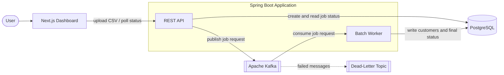
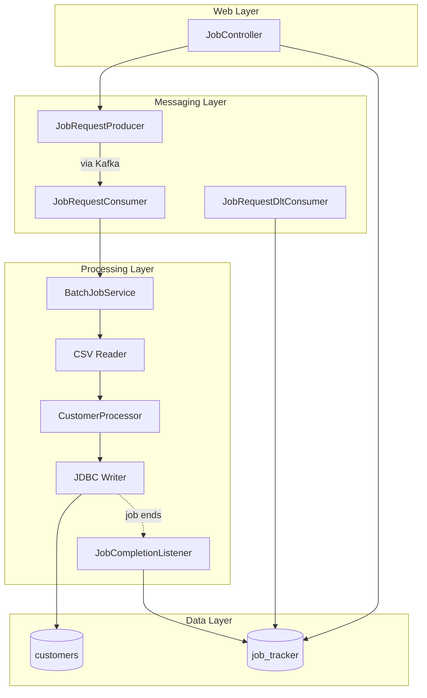
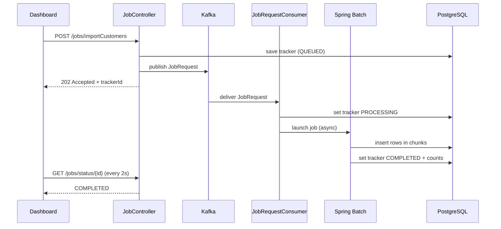
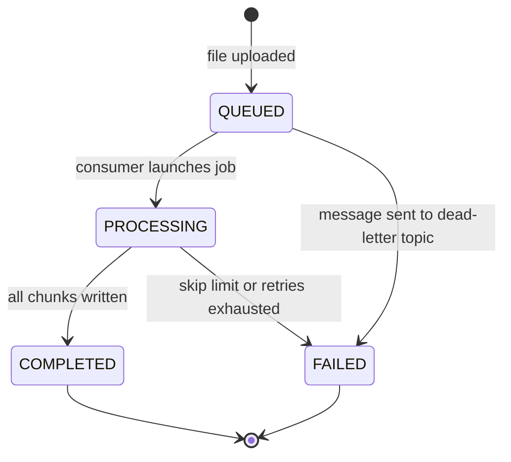
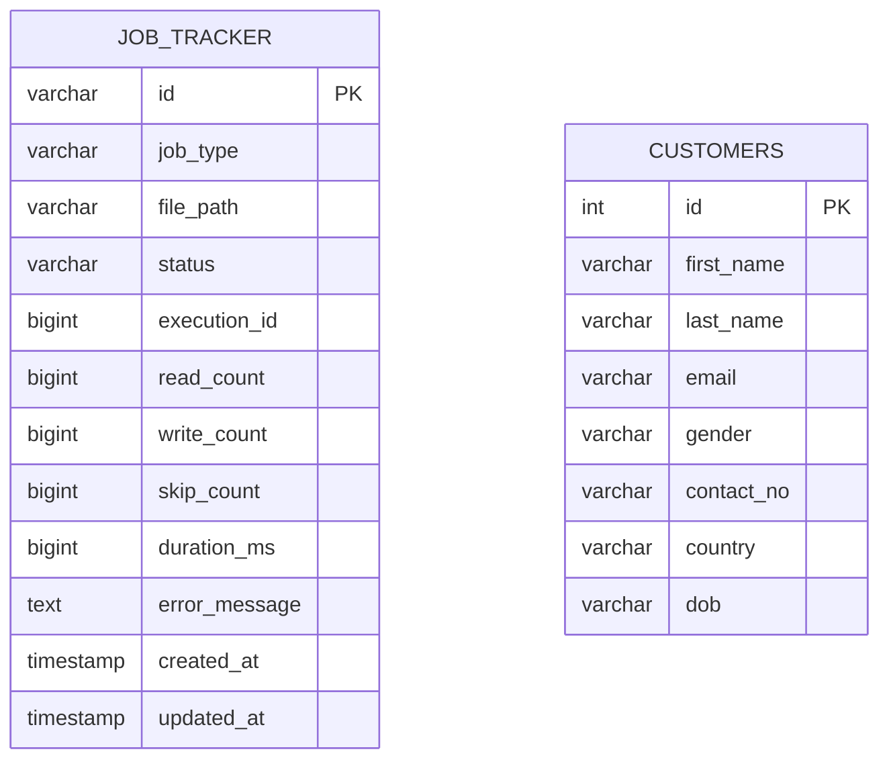

<p align="center">
  <picture>
    <source media="(prefers-color-scheme: dark)" srcset="https://shieldcn.dev/header/graph.svg?title=RTDPS&subtitle=Event-driven+CSV+ingestion+with+Kafka,+Spring+Batch+and+PostgreSQL&logo=apachekafka&align=left&mode=dark" />
    
  </picture>
</p>

<p align="center">
  <picture>
    <source media="(prefers-color-scheme: dark)" srcset="https://shieldcn.dev/badge/Java-21.svg?logo=openjdk&logoColor=ED8B00&variant=secondary&mode=dark" />
    
  </picture>
  <picture>
    <source media="(prefers-color-scheme: dark)" srcset="https://shieldcn.dev/badge/Spring_Boot-3.5.svg?logo=springboot&logoColor=6DB33F&variant=secondary&mode=dark" />
    
  </picture>
  <picture>
    <source media="(prefers-color-scheme: dark)" srcset="https://shieldcn.dev/badge/Apache_Kafka-3.8.svg?logo=apachekafka&logoColor=FFFFFF&variant=secondary&mode=dark" />
    
  </picture>
  <picture>
    <source media="(prefers-color-scheme: dark)" srcset="https://shieldcn.dev/badge/PostgreSQL-17.svg?logo=postgresql&logoColor=4169E1&variant=secondary&mode=dark" />
    
  </picture>
  <picture>
    <source media="(prefers-color-scheme: dark)" srcset="https://shieldcn.dev/badge/Next.js-16.svg?logo=nextdotjs&logoColor=FFFFFF&variant=secondary&mode=dark" />
    
  </picture>
  <a href="https://github.com/Yaswanth6303/rtdps/commits/main">
    <picture>
      <source media="(prefers-color-scheme: dark)" srcset="https://shieldcn.dev/github/last-commit/Yaswanth6303/rtdps.svg?variant=secondary&mode=dark" />
      
    </picture>
  </a>
</p>

---

## Overview

RTDPS imports large CSV files into PostgreSQL **without making the user wait**.

The REST API stores the upload, records the job as `QUEUED`, publishes a request to Apache Kafka and returns `202 Accepted` immediately. A Kafka consumer starts a Spring Batch job on its own thread pool, which reads the file in parallel chunks, cleans every row and writes it with an idempotent insert. Failed messages are routed to a dead-letter topic, and every job's status and counts are stored in a tracker table that a Next.js dashboard polls in real time.

### Why it exists

| Problem with a synchronous import | How RTDPS solves it |
|---|---|
| The HTTP request is held open for the whole import | Kafka decouples upload from processing; the API answers in milliseconds |
| Rows are processed one at a time | A multithreaded, chunk-based Spring Batch step processes the file in parallel |
| Failures are silent or crash the import | Retries, per-row skip logging, a dead-letter topic and a persisted job tracker |
| Kafka can deliver a message more than once | A duplicate-message guard plus `INSERT ... ON CONFLICT DO NOTHING` |

---

## Contents

- [Features](#features)
- [High-Level Design](#high-level-design)
- [Low-Level Design](#low-level-design)
- [Fault Tolerance](#fault-tolerance)
- [Performance](#performance)
- [Tech Stack](#tech-stack)
- [Getting Started](#getting-started)
- [Configuration](#configuration)
- [REST API](#rest-api)
- [CSV Format](#csv-format)
- [Testing](#testing)
- [Project Structure](#project-structure)
- [Roadmap](#roadmap)

---

## Features

- **Asynchronous ingestion** — uploads return `202 Accepted`; jobs run on a dedicated launcher thread pool.
- **Parallel chunk processing** — a thread-safe reader feeds worker threads, 20 rows per chunk, batched JDBC writes.
- **Idempotent by design** — duplicate Kafka messages are ignored and existing rows are never duplicated.
- **Fault tolerant** — database retries, Kafka backoff retries and a dead-letter topic.
- **Data cleaning** — trims fields, lowercases emails, capitalizes names and filters invalid emails.
- **Per-job error log** — malformed rows are written to `batch-error-logs/<trackerId>_missing_columns.log`.
- **Live job tracking** — status, read / write / skip counts and duration stored in PostgreSQL.
- **Dashboard** — drag-and-drop upload, live status updates, light and dark themes.
- **Schema as code** — Flyway migrations; Hibernate only validates.
- **End-to-end tested** — real PostgreSQL through Testcontainers plus an embedded Kafka broker.

---

## High-Level Design

The system has three parts: a dashboard, one Spring Boot application (API and batch worker) and two pieces of infrastructure (Kafka and PostgreSQL).



| Component | Responsibility |
|---|---|
| Next.js Dashboard | Upload files and show live job status |
| REST API | Validate and store uploads, create the job tracker, publish to Kafka, serve status |
| Apache Kafka | Durable queue of job requests with retries and a dead-letter topic |
| Batch Worker | Read, clean and write CSV rows in parallel chunks |
| PostgreSQL | Store customers, job trackers and Spring Batch metadata |

---

## Low-Level Design

### Components



### Upload flow



### Job lifecycle



### Data model



Spring Batch's own `BATCH_*` metadata tables are created by Flyway migration `V1`.

### Kafka topics

| Topic | Partitions | Consumer group | Purpose |
|---|---|---|---|
| `job-requests` | 3 | `rtdps-group` | Import requests from the API, keyed by tracker ID |
| `job-events` | 3 | `rtdps-events-group` | Job-completion events |
| `job-requests.DLT` | 1 | `rtdps-dlt-group` | Requests that failed permanently |

### Thread pools

| Pool | Core / Max | Purpose |
|---|---|---|
| `job-launcher-*` | 4 / 8 | Runs whole jobs, so the Kafka consumer thread is never blocked |
| `batch-thread-*` | 10 / 20 | Processes chunks inside a job |

The pools are kept separate so new job launches can never starve the chunks of jobs already running.

---

## Fault Tolerance

| Scenario | Handling | Result |
|---|---|---|
| Row with a missing column or invalid `id` | Skipped and written to the job's error log (limit 100) | Job continues |
| Row with an invalid email | Filtered out by the processor | Job continues |
| Temporary database failure | Chunk retried up to 3 times | Job continues |
| Malformed JSON message | `ErrorHandlingDeserializer` routes it straight to the DLT | Tracker `FAILED` |
| Missing tracker or upload file | Non-retryable, sent straight to the DLT | Tracker `FAILED` |
| Job launch failure | Retried 3 times, 1 second apart, then sent to the DLT | Tracker `FAILED` if all retries fail |
| Duplicate Kafka message | Ignored unless the tracker is still `QUEUED` | No second run |
| Row whose `id` already exists | `ON CONFLICT (id) DO NOTHING` | No duplicate row |

---

## Performance

Measured locally on the same import, single-threaded versus the multithreaded step:

| Records | Single-threaded | Multithreaded |
|---:|---:|---:|
| 1,000 | ~6 s | **~100 ms** |
| 50,000 | — | **~2.5 s** |

---

## Tech Stack

| Layer | Technology |
|---|---|
| Language | Java 21 |
| Backend | Spring Boot 3.5.5, Spring Batch 5.2, Spring Kafka, Spring Data JPA |
| Messaging | Apache Kafka 3.8 (KRaft mode, no ZooKeeper) |
| Database | PostgreSQL 17, Flyway 11, HikariCP |
| API docs | springdoc OpenAPI (Swagger UI) |
| Frontend | Next.js 16, React 19, TypeScript, Tailwind CSS 4, shadcn/ui, Bun |
| Testing | JUnit 5, AssertJ, Testcontainers, Spring Kafka Test (EmbeddedKafka), Awaitility |
| Build and runtime | Gradle, Podman / Docker Compose, multi-stage Dockerfile |

---

## Getting Started

### Prerequisites

- Java 21
- Bun
- Podman or Docker

### 1. Clone and configure

```bash
git clone https://github.com/Yaswanth6303/rtdps.git
cd rtdps
cp .env.example .env
```

### 2. Start PostgreSQL and Kafka

```bash
podman compose up -d postgres kafka
```

### 3. Run the backend

```bash
./gradlew bootRun
```

The API runs on `http://localhost:9191`, with Swagger UI at `http://localhost:9191/swagger-ui.html`.

### 4. Run the dashboard

```bash
cd client
bun install
bun dev
```

Open `http://localhost:3000`, upload a CSV and watch the job move from **Queued** to **Processing** to **Completed**.

### Run everything in containers

```bash
podman compose --profile production up -d --build
```

---

## Configuration

Settings are read from `.env` (loaded by `spring-dotenv`) or environment variables. Defaults match `docker-compose.yml`.

| Variable | Default | Description |
|---|---|---|
| `POSTGRES_URL` | `jdbc:postgresql://localhost:5432/rtdps` | JDBC URL |
| `POSTGRES_USER` | `postgres` | Database user |
| `POSTGRES_PASSWORD` | `password` | Database password |
| `KAFKA_BOOTSTRAP_SERVERS` | `localhost:29092` | Kafka brokers (`kafka:9092` inside Compose) |
| `RTDPS_API_URL` | `http://localhost:9191` | Backend URL used by the dashboard proxy |

---

## REST API

| Method | Endpoint | Description |
|---|---|---|
| `POST` | `/jobs/importCustomers` | Upload a CSV (multipart field `file`); returns `202 Accepted` |
| `GET` | `/jobs/status/{trackerId}` | Status and counts for one job |
| `GET` | `/jobs/all` | All jobs, newest first |
| `GET` | `/swagger-ui.html` | Interactive API documentation |

**Upload a file**

```bash
curl -F "file=@customers.csv" http://localhost:9191/jobs/importCustomers
```

```json
{
  "message": "Import job queued successfully",
  "trackerId": "3f2b8c1e-7a4d-4e5b-9c1a-2d6f8e0b4a71",
  "status": "QUEUED",
  "filePath": "/app/uploads/1760280000000_customers.csv"
}
```

**Check a job**

```bash
curl http://localhost:9191/jobs/status/3f2b8c1e-7a4d-4e5b-9c1a-2d6f8e0b4a71
```

```json
{
  "id": "3f2b8c1e-7a4d-4e5b-9c1a-2d6f8e0b4a71",
  "jobType": "IMPORT",
  "status": "COMPLETED",
  "readCount": 1000,
  "writeCount": 1000,
  "skipCount": 0,
  "durationMs": 100
}
```

---

## CSV Format

The first line is a header and is skipped. Columns must appear in this order:

```csv
id,firstName,lastName,email,gender,contactNo,country,dob
1,Ada,Lovelace,ada@example.com,F,555-111,UK,1815-12-10
2,Alan,Turing,alan@example.com,M,555-222,UK,1912-06-23
```

---

## Testing

```bash
./gradlew test
```

| Test | Type | Coverage |
|---|---|---|
| `CustomerProcessorTest` | Unit (7) | Trimming, email normalization, name capitalization, invalid-email filtering |
| `RtdpsApplicationTests` | Smoke | Application context loads with H2 and a mocked Kafka template |
| `BatchImportIntegrationTest` | End-to-end (3) | Upload to Postgres happy path; missing file and malformed JSON both end `FAILED` via the DLT |

> [!NOTE]
> The end-to-end tests start PostgreSQL with Testcontainers, so a container runtime must be running. With Podman on macOS:
>
> ```bash
> export DOCKER_HOST="unix://$(podman machine inspect <machine-name> --format '{{.ConnectionInfo.PodmanSocket.Path}}')"
> export TESTCONTAINERS_RYUK_DISABLED=true
> ```

---

## Project Structure

```
rtdps/
├── src/main/java/me/yswnthdev/rtdps/
│   ├── config/          Kafka topics and error handling, Spring Batch job and thread pools
│   ├── controller/      REST endpoints
│   ├── dto/             Kafka payloads (JobRequest, JobEvent)
│   ├── entity/          JPA entities (Customer, JobTracker)
│   ├── exception/       Global exception handler
│   ├── kafka/           Producers, consumers and the dead-letter consumer
│   ├── listener/        Job completion listener
│   ├── repository/      Spring Data JPA repositories
│   ├── service/         Job launcher service and row processor
│   └── utils/           CSV field mapper and per-job error logger
├── src/main/resources/
│   ├── application.yml
│   └── db/migration/    V1 batch metadata, V2 customers, V3 job_tracker
├── src/test/            Unit, smoke and end-to-end tests
├── client/              Next.js dashboard
├── docker-compose.yml   PostgreSQL 17 and Kafka (KRaft)
└── Dockerfile           Multi-stage build, non-root runtime
```

---

## Roadmap

- [ ] Live progress counts while a job is running
- [ ] Recovery for jobs left in `PROCESSING` after a crash
- [ ] Transactional outbox for the tracker save and Kafka publish
- [ ] Retry and download actions on the dashboard
- [ ] CSV header validation
- [ ] Prometheus metrics and Kubernetes health probes

---

<p align="center">
  Built by <a href="https://github.com/Yaswanth6303"><strong>Yaswanth Gudivada</strong></a>
</p>
